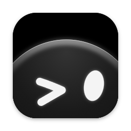
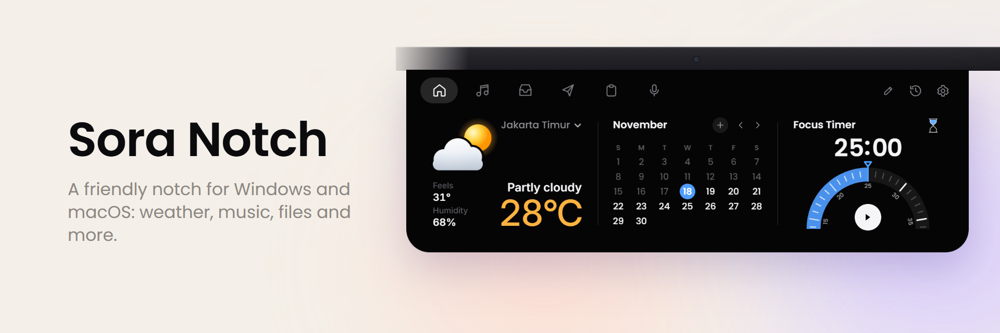
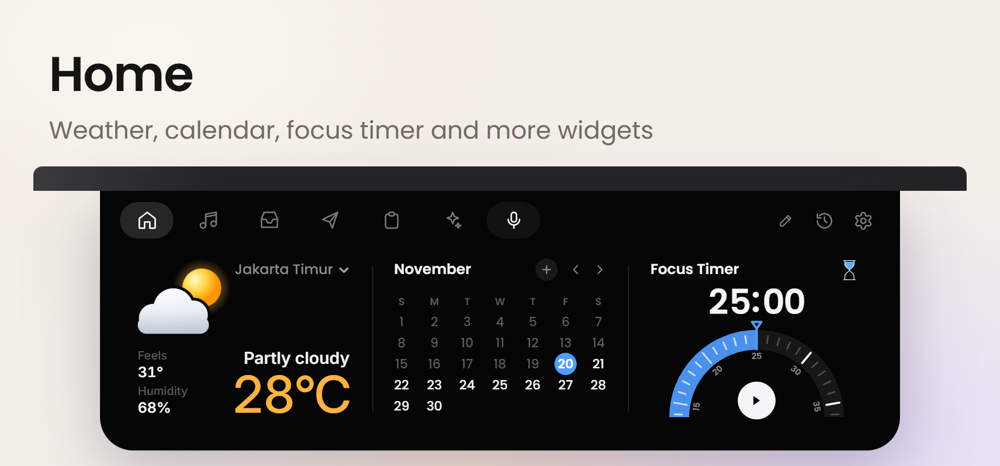
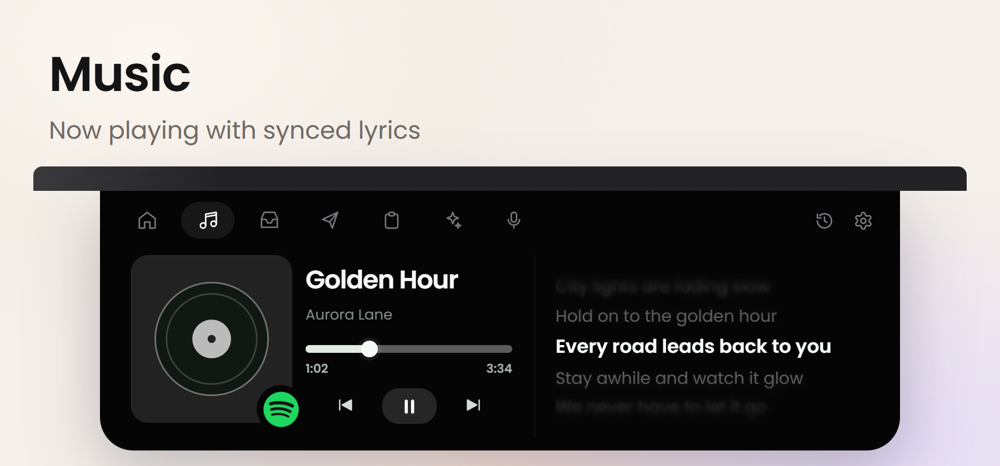
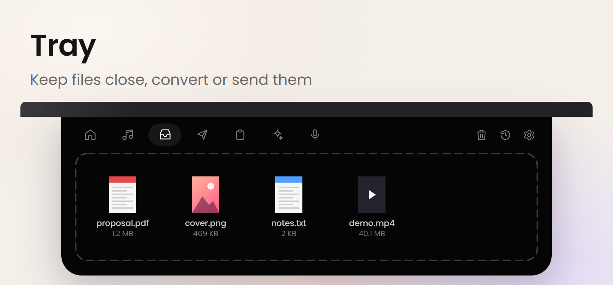
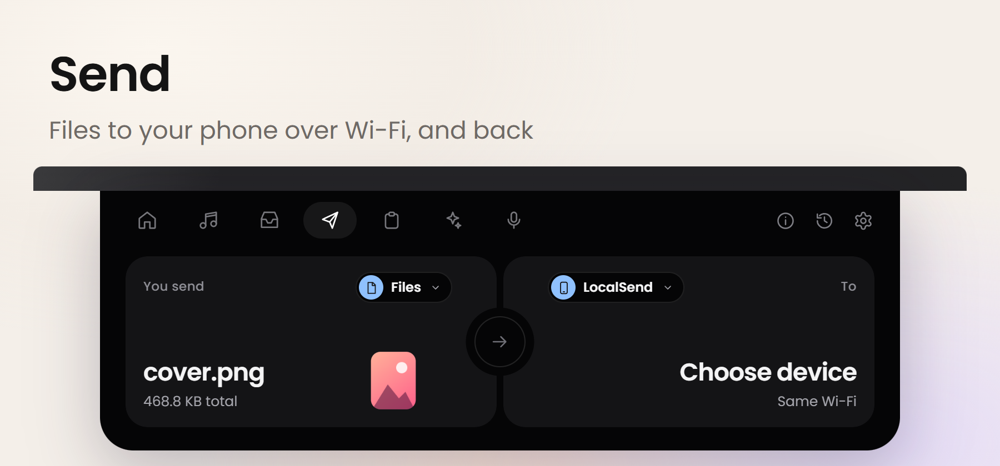
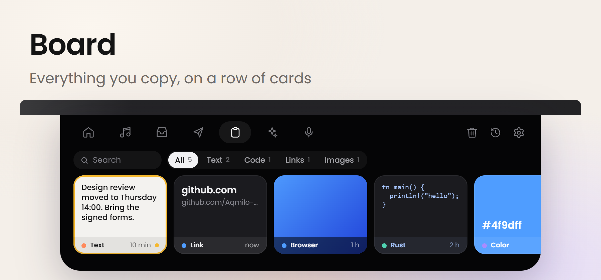
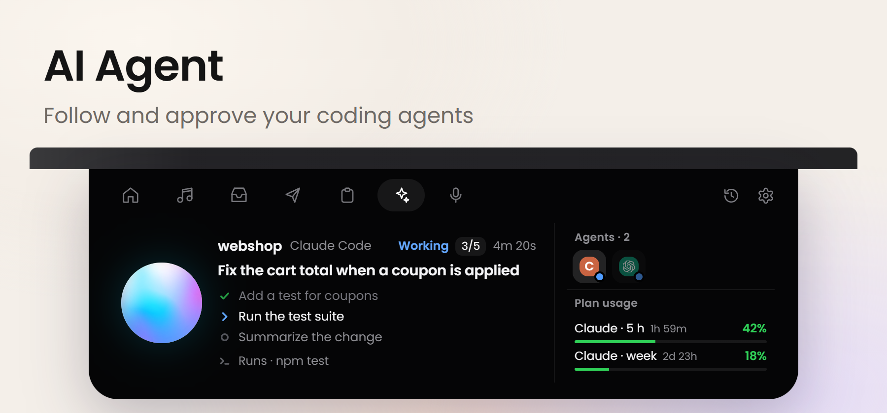
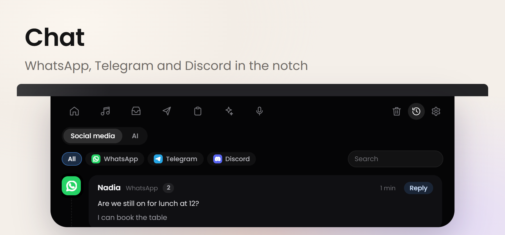
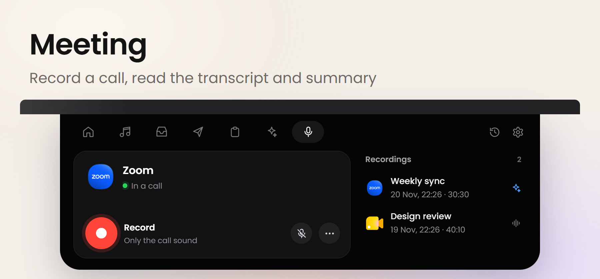

<div align="center">



# Sora Notch

**A friendly notch for Windows and macOS: weather, music, files and more.**

A little black notch with a face lives at the top of your screen. Click it and it opens into a panel with everything you reach for during the day.


<a href="https://github.com/Aqmilo-Works/sora-notch/releases/download/v1.0.0/SoraNotch-1.0.0-x64.msi"></a>
<a href="https://apps.microsoft.com/detail/9p58p6lvwkvl?mode=direct"></a>
<a href="https://github.com/Aqmilo-Works/sora-notch/releases/download/v1.0.0/SoraNotch-1.0.0-macOS.dmg"></a>

<sub>Portable Windows .exe and source code: <a href="https://github.com/Aqmilo-Works/sora-notch/releases/latest">all downloads</a></sub>



</div>

## Preview

<table>
<tr>
<td width="50%"></td>
<td width="50%"></td>
</tr>
<tr>
<td></td>
<td></td>
</tr>
<tr>
<td></td>
<td></td>
</tr>
</table>

### Beta

Chat and the meeting recorder are in this GitHub version on Windows, still in beta.

<table>
<tr>
<td width="50%"></td>
<td width="50%"></td>
</tr>
</table>

## Features

- **A notch with a face.** A small notch at the top of your screen with a mascot that wakes up, blinks and sways to your music.
- **Home.** Widgets you choose: weather, a week calendar, to-dos, alarms, a focus timer, now playing, market prices, a live system monitor (CPU, GPU, memory, disk, network), screen time, a water reminder and prayer times.
- **Music.** Now playing from any media app (Spotify, browsers, players), with controls and synced lyrics. Japanese, Korean and Chinese lyrics can switch to romanization.
- **Tray.** Drag files onto the notch to keep them close, drag them out again when you need them. Right-click a file to convert it (images, video, audio, documents) or send it.
- **Send.** Send files to your phone over Wi-Fi with LocalSend, with Quick Share on Android, or to an iPhone or Mac through a QR code and a 6-digit code, with no app needed. Nearby devices appear on a small radar. Phones and PCs with LocalSend can also send files to Sora: a notice under the notch asks first (Accept or Deny), and accepted files land in Downloads and the Tray.
- **Board.** Everything you copy (text, links, images) on a row of cards. Pin it with Keep, preview links, read the text inside a picture (OCR), save or share an item.
- **AI Agent.** See what Claude Code, Codex, Gemini CLI and Antigravity are doing, approve their actions from the notch, and watch your plan usage.
- **Stays out of the way.** For full-screen apps and games Sora shrinks into a small capsule at the top edge. Rest the pointer on it to bring Sora back.
- **Keyboard shortcut.** `Ctrl + Alt + Space` (`Cmd + Shift + Space` on a Mac) shows or hides Sora (change it in Settings).
- **Private.** No account, no ads, no tracking. Your events, timer, settings and tray stay on your computer.

**Beta** *(GitHub version, Windows)*

- **Chat in the notch.** Messages from chat apps such as WhatsApp, Telegram and Discord appear in the notch instead of a Windows pop-up, with a 30-day encrypted history. Link WhatsApp or Telegram to reply right from the notch.
- **Meeting recorder.** Records a call (the app you choose, optionally your microphone), then transcribes it on your PC with speaker labels and writes a summary on your PC or, if you choose, with your own cloud AI key.

## Install

Every [release](../../releases/latest) has these files:

| File | For |
|-|-|
| `SoraNotch-<version>-x64.msi` | **Windows installer (recommended).** Installs for your user only (no administrator rights) in `%LOCALAPPDATA%\Programs\Sora` with a Start menu shortcut. A newer installer replaces an older one. |
| `SoraNotch-<version>-portable.exe` | **Windows, portable.** No installation: run it from any folder you can write to. Keep it there, since it updates itself in place. |
| `SoraNotch-<version>-macOS.dmg` | **macOS 12 or later**, Apple silicon and Intel. Open it and drag Sora into Applications. The first time, open it from System Settings > Privacy & Security > Open Anyway. |
| Source code | The code of that version. |

**Microsoft Store:** [Sora Notch on the Microsoft Store](https://apps.microsoft.com/detail/9p58p6lvwkvl?mode=direct) (the link opens the Store app). The Store version leaves out the meeting recorder and the chat apps, and updates through the Store.

**From source:** see [Build](#build) below.

Sora (the installer, the portable copy and the Mac app) looks for a new version once a day and installs it only if the file matches the update information signed by the publisher (Settings > General > Updates).

**Uninstall:** Windows Settings > Apps for the installer and the Store version; Settings > General > Uninstall Sora for the portable copy and on a Mac. Either way all of Sora's data goes too, so a new install starts fresh.

Requirements: Windows 10 (version 1903) or Windows 11, x64, with the Microsoft WebView2 Runtime (included in Windows 11); or macOS 12 or later. The release files are not code-signed, so Windows SmartScreen or macOS Gatekeeper may ask you to confirm. The meeting recorder and the chat apps are in this GitHub version on Windows only; the Store version and the Mac app leave them out.

## Using Sora

| Action | How |
|-|-|
| Open the panel | Click the notch. |
| Close the panel | Click outside it, or press `Esc`. |
| Show or hide Sora | `Ctrl + Alt + Space`, or the tray icon menu. |
| Bring Sora back from the capsule | Rest the pointer on the capsule for about two seconds. |
| Add files to the Tray | Drag them from File Explorer onto the notch. |
| Convert or send a file | Right-click it in the Tray. |
| Settings | The gear in the panel, or the tray icon menu. |

Settings include Start with Windows, Hide when maximized, Game Mode (Off, Auto full-screen, Always hidden) and the edge capsule.

## Privacy

Sora has no analytics and no account system; the only Sora-run servers are static pages (send.soranotch.com, update.soranotch.com) that hold no user data. It goes online for these features, and only when you use them. The Microsoft Store edition has no chat or auto-update rows.

| Feature | Service | What is sent |
|-|-|-|
| Weather | [Open-Meteo](https://open-meteo.com) | The coordinates of the city you chose. |
| Place names | OpenStreetMap Nominatim, BigDataCloud | Your coordinates, or the place you search for. |
| Approximate location (only if Windows location is unavailable) | ipwho.is, ipapi.co | Nothing but the request: they see your IP address. |
| Markets | Yahoo Finance | The symbols you added. |
| Lyrics | [LRCLIB](https://lrclib.net), Lyrics.ovh, NetEase Cloud Music, QQ Music | Title, artist and album of the song that is playing. |
| Link previews | The linked website | A plain request for a link you copied. |
| Send | Your own devices on your local network | The files you choose, directly from PC to phone. The iPhone/Mac QR page is static (send.soranotch.com, with Cloudflare DNS); it only learns a random name and your local address. |
| Meeting recorder | GitHub, Hugging Face | Downloads of the transcript and summary models you choose to install. |
| Cloud summaries (off by default) | The AI service you pick | The transcript of one meeting, only when you click Summarize. |
| WhatsApp, Telegram (GitHub edition, only if you link them) | WhatsApp, Telegram | Your messages, as the official apps send them. WhatsApp is an unofficial connection. |
| Claude usage (AI Agent on) | api.anthropic.com | A request with your own Claude Code login. |
| Updates, chat helpers (not the Store edition) | update.soranotch.com, GitHub | A plain request for a newer version, then the download from this repository's release. |

Files are never uploaded. Read the full [Privacy Policy](PRIVACY.md).

## Build

You need:

- Rust (stable, MSVC toolchain)
- Visual Studio C++ Build Tools and the Windows 10/11 SDK
- Microsoft WebView2 Runtime

Then run in PowerShell:

```powershell
./build.ps1
```

The app is written to `target/release/sora.exe`. The interface, fonts, city data and converter tools are bundled, so Node.js is not needed for a normal build. `build.ps1` remaps source paths so that your user name does not end up inside the program. If a `modules` folder with the WhatsApp and Telegram helpers is present it is packed into `Sora.exe`; without it those two chat apps are simply unavailable. `cargo build --release --locked --features store` makes the Store edition.

### Tests

```powershell
cargo test --release --locked
npm test
```

`npm run test:ui` runs the interface tests. They need Playwright installed.

### Installer (.msi)

```powershell
./installer/build-msi.ps1 -Build
```

`installer/build-msi.ps1` builds `dist/SoraNotch-<version>-x64.msi` with [WiX 3.14](https://github.com/wixtoolset/wix3/releases) (unzip `wix314-binaries.zip` next to the repository as `wix3in`, or pass `-Wix <folder>`; .NET is not needed). The installer has a Welcome, Destination folder and Finish wizard (`installer/Sora.wxs`). It refuses to package an executable that contains the builder's user name. Publish a release `v<version>` with the `.msi`, `SoraNotch-<version>-portable.exe` (the same Sora.exe as in the installer) and the macOS `.dmg`. The update information (version, SHA-256 and size of each file) is signed and published separately at update.soranotch.com; the release holds no signature files. Point the download buttons at the top of this page to the new version's files (images in `docs/download`, made by `docs/download/render.cjs`).

### Microsoft Store package

The Store edition is built from the `Sora-Public` copy of this code (`--features store`), not from here.

## Project layout

| Path | Contents |
|-|-|
| `src/` | Rust backend: windows, notch shape, media, tray, conversion, LocalSend and Quick Share senders. |
| `ui/` | HTML, CSS and JavaScript for the notch, panel and Settings. |
| `data/` | Offline city catalogue (GeoNames) and the bundled FFmpeg and ImageMagick converters. |
| `romanization/` | Source of the bundled lyric romanization script. |
| `tools/` | Scripts to rebuild the converter bundles and the macOS artwork. |
| `installer/` | The .msi builder. |
| `docs/` | Images for this page. |
| `tests/` | Logic and interface tests. |

## Credits and licenses

- Fonts: Poppins and Noto Sans JP/KR/SC (SIL Open Font License), Inter. See `ui/fonts/` and `ui/Inter-LICENSE.txt`.
- City data: [GeoNames](https://www.geonames.org) (CC BY 4.0). See `data/GeoNames-LICENSE.txt`.
- Converters: [FFmpeg](https://ffmpeg.org) (GPLv3 build by gyan.dev) and [ImageMagick](https://imagemagick.org), unchanged. Licenses and source links are inside each bundle in `data/converter/`.
- Romanization: Kuroshiro, Kuromoji, es-hangul and pinyin-pro. See `ui/vendor/licenses/`.
- Player, browser and chat app icons: [Simple Icons](https://simpleicons.org) (CC0), plus the apps' own icons for Meeting and music players. Trademarks belong to their owners. See `ui/logos/`.
- Meeting: [whisper.cpp](https://github.com/ggml-org/whisper.cpp) and the Whisper models (MIT), Silero VAD (MIT), [llama.cpp](https://github.com/ggml-org/llama.cpp) (MIT) with the Qwen3.5 models (Apache-2.0), [sherpa-onnx](https://github.com/k2-fsa/sherpa-onnx) (Apache-2.0) with pyannote segmentation (MIT) and 3D-Speaker (Apache-2.0). They are downloaded on request; the Vulkan build of ggml for Whisper inside Sora is built from the same MIT source.
- Chat: [whatsmeow](https://github.com/tulir/whatsmeow) (MPL-2.0) and [TDLib](https://github.com/tdlib/td) (BSL-1.0), as separate helper programs packed into the GitHub build.
- Weather data by [Open-Meteo](https://open-meteo.com). Lyrics by [LRCLIB](https://lrclib.net) and other lyric providers.

Sora is not affiliated with Microsoft, Google, Spotify, WhatsApp, Telegram, Anthropic, OpenAI or any music, lyrics or chat service. WhatsApp support uses an unofficial connection, and WhatsApp may limit accounts that use one. Quick Share support is an independent, interoperable implementation and may stop working if Google changes the protocol.

## License

Sora is free software under the [GNU General Public License v3.0](LICENSE). You may use, study, change and share it; if you distribute a modified version, you must share its source under the same license. The name "Sora Notch" and the mascot are not covered by this license.

## Contact

Questions or feedback: open an issue, or email aqmilooooo@gmail.com.

© 2026 Aqmilo Works
